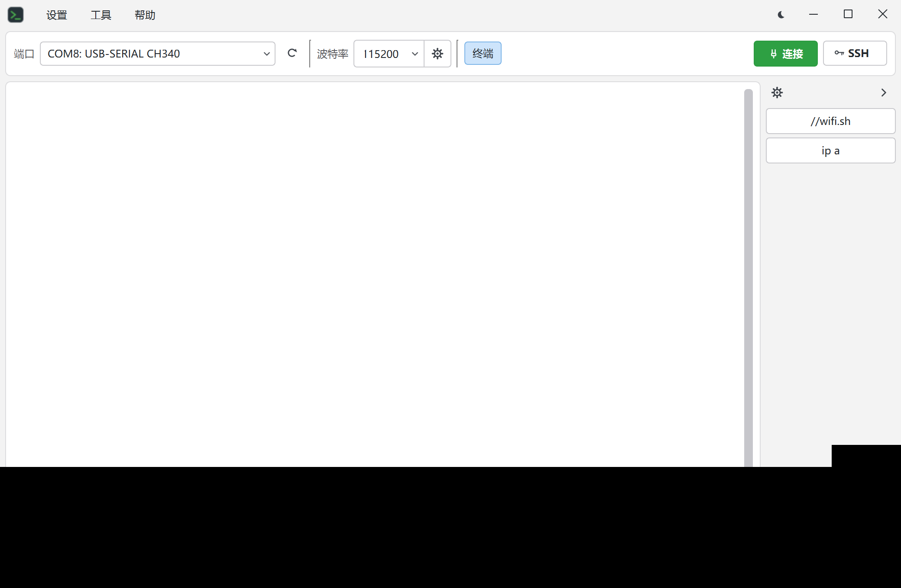
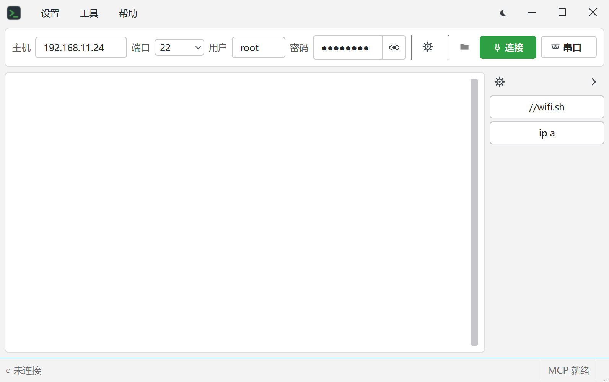
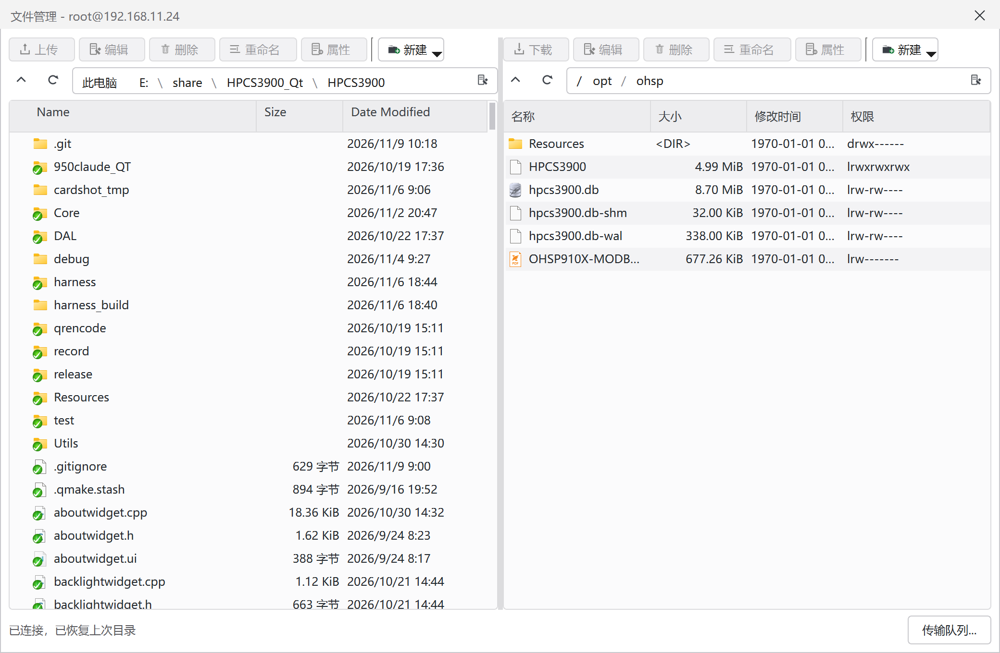

# Xterm

[](https://github.com/yyp-U/Xterm/releases) [](LICENSE) [](https://github.com/yyp-U/Xterm/releases)

面向嵌入式开发的**串口 + SSH 双模终端**（Windows / Qt 6 / C++17）。

一条串口链路 + 一条 SSH 链路同时存活、一键切换；SFTP 双栏文件管理复用 SSH 同一条连接；命令栏、关键词高亮、滚动历史查找，并内置 MCP 桥——本机 AI（Claude 等）可直接读屏、发命令。Win11 原生体验：无边框窗口、暗/亮主题、圆角弹窗。

> **下载**：[Xterm-0.1.0-win64-portable.zip](https://github.com/yyp-U/Xterm/releases/download/v0.1.0/Xterm-0.1.0-win64-portable.zip)（免安装，解压后直接运行 `bin\Xterm.exe`，无需安装 Qt 或其他运行库）

## 界面预览

**主界面（串口终端）**



**SSH 连接参数**



**SFTP 文件管理**



## 功能亮点

- **自绘格子终端**：VT 转义全解析（光标定位、滚动区、备用屏、16/256/真彩色），`vim` / `htop` 等全屏程序正常渲染与退出还原
- **双链路独立存活**：串口与 SSH 互不干扰，F9 切换不断线，两边可同时在线
- **SFTP 文件管理**（WinSCP 风格）：左本地右远程，各自工具栏与右键菜单；上传支持整文件夹递归，传输进度实时显示
- **命令栏**：常用命令做成按钮一点即发；整栏可收起，状态持久化
- **关键词高亮**：可配置规则 + 内置日志惯例默认（错误红/成功绿…），选中词右键一键添加
- **客户端 Tab 补全**：内置 Linux 常用命令 + 命令栏命令自动成为候选
- **主机状态**：状态栏实时显示远端 CPU / 内存（共享连接的独立通道）
- **MCP 桥**：命名管道 + 令牌，AI 工具可读屏 / 发命令 / 发裸字节 / 等待文本
- **串口行编辑与全屏程序自动共存**：远端一画屏，行编辑自动让路直通；回落纯文本自动恢复

## 快捷键

| 键 | 作用 |
|---|---|
| F5 | 连接 / 断开 |
| F9 | 切换串口 / SSH（两条链路都不断开） |
| F10 | 打开 SFTP 文件管理 |
| Ctrl+F / Ctrl+Shift+F | 滚动历史查找 |
| Ctrl+滚轮 | 调整字号 |
| F1–F8、F11、F12 | 不占用，原样透传给远端程序 |

## 环境要求

- Windows 10/11 x64
- [Qt 6.8.x](https://www.qt.io/) **llvm-mingw 64-bit** 套件（含 Qt 库与 llvm-mingw 工具链）
- CMake ≥ 3.19、Ninja、Git（Qt 在线安装器里均可勾选，或独立安装）

## 获取与构建

### 1) 第三方依赖（libssh + OpenSSL）

仓库已内置预编译依赖 `.deps/vcpkg_installed/x64-mingw-dynamic/`（约 34 MB），克隆后**无需联网安装，直接进入下一步**。

需要升级或重建依赖时（可选）：

```powershell
powershell -File scripts/bootstrap-ssh-deps.ps1
```

脚本会用 vcpkg 以清单模式安装 libssh 0.12.2 与 OpenSSL 3.6.5 到 `.deps/vcpkg_installed/`（约 34 MB 产物；vcpkg 工具本体缓存约 1.5 GB，不入库，可随时删除重建）。

### 2) 配置与构建

**Qt Creator 方式**（推荐）：直接打开 `CMakeLists.txt`，选择 *Desktop Qt 6.8.x llvm-mingw 64-bit* 套件即可。

**命令行方式**：

```powershell
cmake -S . -B build -G Ninja `
  -DCMAKE_BUILD_TYPE=Release `
  -DCMAKE_PREFIX_PATH=D:/Qt6/6.8.3/llvm-mingw_64 `
  -DCMAKE_C_COMPILER=D:/Qt6/Tools/llvm-mingw1706_64/bin/clang.exe `
  -DCMAKE_CXX_COMPILER=D:/Qt6/Tools/llvm-mingw1706_64/bin/clang++.exe `
  -DCMAKE_MAKE_PROGRAM=D:/Qt6/Tools/Ninja/ninja.exe
cmake --build build --target Xterm
```

### 3) 运行测试

```powershell
ctest --test-dir build --output-on-failure
```

### 4) 打包发布（生成可独立运行的 install 目录）

```powershell
cmake --build build --config Release --target Xterm
powershell -File scripts/package.ps1 -BuildDir build
```

打包产物在 `build/install/`，含 Xterm.exe、Qt 运行库、libssh/OpenSSL DLL 与 MCP 工具，解压即用。

## 构建选项

| CMake 变量 | 默认值 | 说明 |
|---|---|---|
| `XTERM_VCPKG_TRIPLET` | `x64-mingw-dynamic` | vcpkg triplet；`.deps/vcpkg_installed/` 下的目录名据此推导 |
| `XTERM_SSH_DEPS_ROOT` | `.deps/vcpkg_installed/<triplet>` | libssh/OpenSSL 安装根目录，已有现成依赖时可显式指定 |
| `XTERM_BUILD_TOOLS` | `OFF` | 构建 `tools/` 下的 sshtest / sftptest 调试工具 |
| `BUILD_TESTING` | `ON` | 构建并注册 `tests/` 测试套件 |

## 目录结构

```
├── CMakeLists.txt        构建入口
├── vcpkg.json            第三方依赖清单（libssh / OpenSSL）
├── ssh/                  libssh 封装：连接、shell/SFTP/stats 通道、known_hosts
├── mainwindow.*          主窗口胶水层（会话/UI/快捷键/主题/MCP 拆为同目录协作类）
├── sshsession.*          SSH 会话 facade（GUI 线程）
├── serialsession.*       串口会话
├── termscreen.*          终端模型（VT 解析、滚动历史）
├── screenview.*          终端视图（自绘、查找、高亮）
├── commandbar.*          可收起命令栏
├── commandstore.*        配置持久化（profile / 关键词 / 命令）
├── filebrowserdialog.*   SFTP 双栏文件管理（UI 编排）
├── filebrowsermodel.*    文件管理数据层（条目/命令/持久化/上传收集）
├── transferqueue.*       传输队列网关（入队/编辑回传/批次跟踪）
├── transferdialog.*      传输队列窗口
├── agentbridge.*         MCP 桥（命名管道 + 令牌）
├── resources/            图标 / QSS 主题 / qrc
├── scripts/              依赖引导（bootstrap）与打包（package）
├── tests/                单元测试（QtTest）
├── tools/                调试小工具（sshtest / sftptest 等，默认不构建）
└── docs/                 软件概览与设计文档
```

## 第三方组件

- **libssh 0.12.2**（LGPL-2.1，动态链接）— SSH2 协议
- **OpenSSL 3.6.5**（Apache-2.0）— 加密后端
- **Qt 6**（用户自行安装）— GUI 框架

完整声明见 [THIRD_PARTY_NOTICES.md](THIRD_PARTY_NOTICES.md)。

## 许可证

本项目以 [MIT License](LICENSE) 开源。
